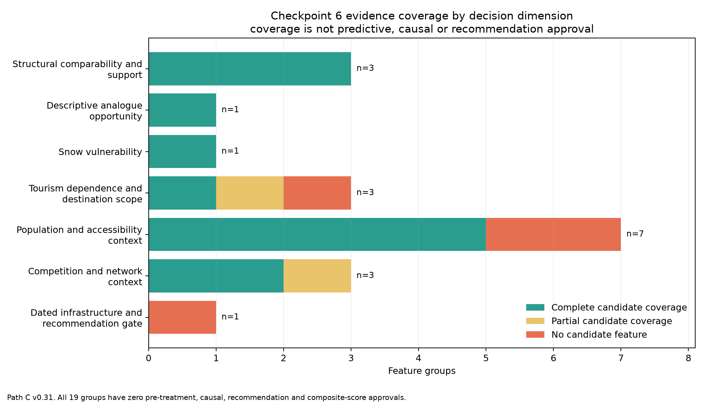
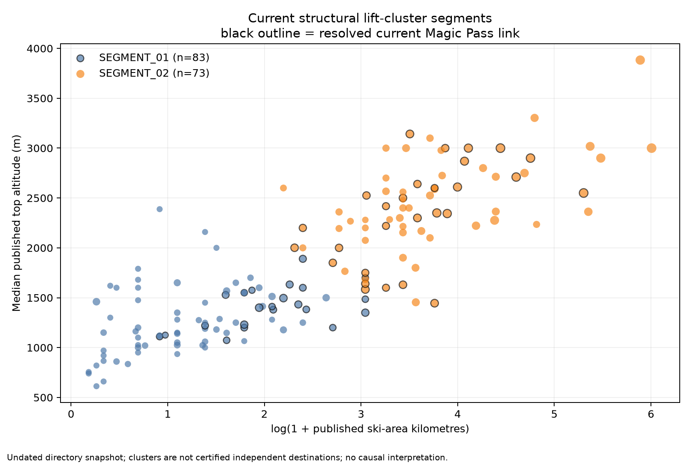
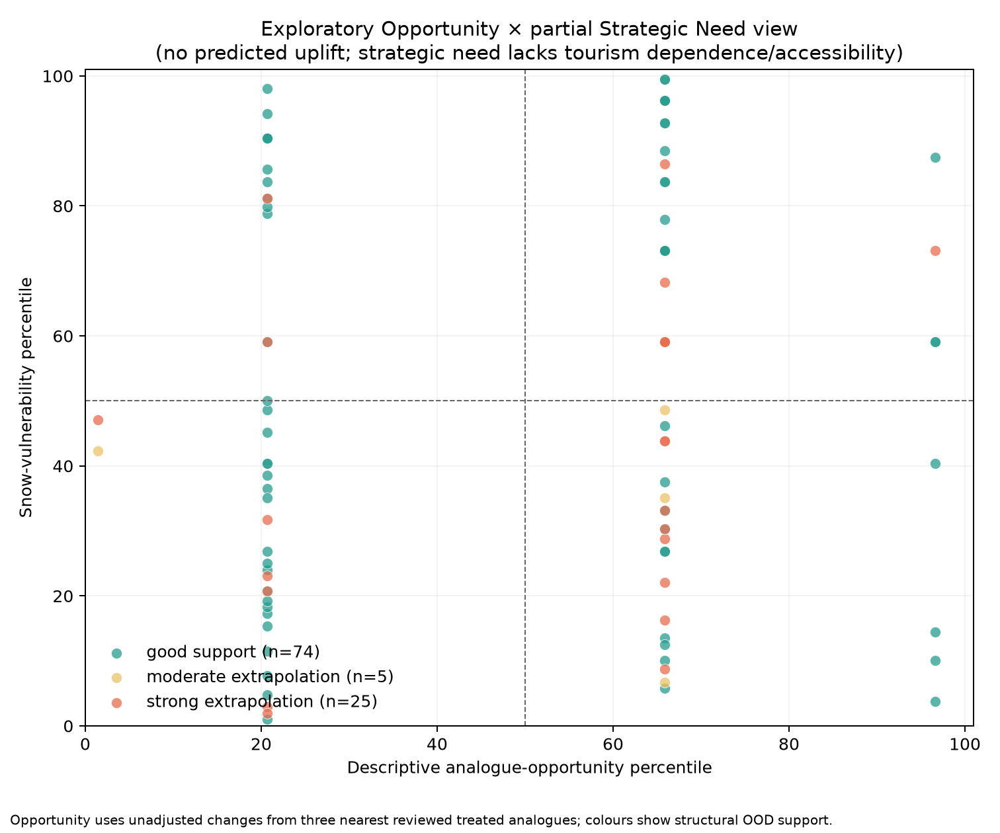

# Master thesis working reading draft

> **Status:** Path C v0.31 working manuscript assembled from validated repository outputs. This file is designed for clear review and revision, not final university typesetting. Counts, claim boundaries and source keys are generated; chapter wording may still change.

## Abstract

This thesis examines whether Swiss ski-resort, hotel-demand, Magic Pass, snow/climate and accessibility data can support causal evaluation and strategic decision support for potential pass expansion. A reproducible pipeline audits 271 directory listings, 242 preserved lift clusters, 186 hotel municipalities and 14 manually reviewed Magic Pass destination units. Although seven units have the joint 24-month pre/post coverage used for diagnostic screening, no treatment or control passes the combined identification gates. Causal Difference-in-Differences, heterogeneous-effect learners and neural networks are therefore rejected. The supported fallback is a seven-dimension exploratory dashboard for 104 apparent candidates. It separates structural similarity, analogue context, snow vulnerability, tourism context, accessibility, competition/network context and evidence gaps. The system produces no predicted uplift, composite score or admission ranking. Its contribution is a transparent Business Analytics architecture that shows what the evidence can support, where it is fragile and what additional data would be required for stronger causal or managerial claims.

## How to read this draft

1. The executive summary states the research decision in plain language.
2. Methods, results and discussion are generated from the same validated summaries used by the tests.
3. The 18-question table provides a fast audit against the original project mission; the complete answers are in `reports/49_FINAL_METHODOLOGICAL_REPORT.md`.
4. The candidate examples illustrate uncertainty categories only. Their order is not a ranking.
5. Temporary `source_id` keys and the bibliography worklist remain separate until the final citation style is chosen.

## 1. Executive summary

### Research decision

This thesis evaluates whether the available Swiss ski-resort, hotel-demand, Magic Pass, snow/climate and accessibility evidence can support causal effect estimation and strategic decision support. The central conclusion is deliberately narrower than the initial ambition: the evidence does **not** support a credible causal estimate of Magic Pass membership, heterogeneous treatment-effect modelling or a ranked admission recommendation. It does support a reproducible exploratory framework that makes structural comparability, contextual evidence and uncertainty visible without combining them into a misleading score.

### Evidence base

The supplied universe contains **271 directory listings**, **242 preserved lift clusters** and **162 clusters linked to at least one listing**. These are not certified independent commercial resorts. The hotel panel contains 31,248 municipality-month rows for 186 municipalities from January 2013 through March 2026. Fourteen Magic Pass destination units were manually reviewed, 11 have an explicit hotel-outcome scope and seven have the joint 24-month pre/post coverage required for the adjacent-window diagnostic.

### Why causal and predictive modelling were rejected

The original donor process screened 315 descriptive treatment-donor pairs and shortlisted 35, but every geographically remote case had a documented contemporaneous local shock. The later municipality-accessibility redesign retained 11 primary pre-period-compatible pairs across 6 treated municipalities. Its explicitly non-causal pilot averages -6.8%, yet the treated-stack t reference gives p=0.099, the five-component sign sensitivity gives p=0.188, and the conservative control exclusion is -2.0% with an interval spanning zero. Zero causal treatments, controls or pairs are approved. The sample and identification therefore remain insufficient for causal forests, meta-learners, uplift models or neural networks.

### Final analytical architecture

Checkpoint 6 selects a **seven-dimension separated evidence dashboard** for 104 apparent candidates. The 19 evidence groups cover structural similarity, analogue opportunity, snow vulnerability, tourism context, accessibility, competition/network context and evidence gaps. Thirteen groups have complete candidate coverage, two are partial and four lack a candidate feature. Coverage is not permission: only structural similarity is approved for exploratory matching, while zero groups are approved as pre-treatment predictors, causal covariates, recommendation inputs or composite-score components.

The structural solution uses top altitude, ski-area kilometres and lift count. Among 156 complete clusters, k=2 achieves silhouette 0.514 and median subsample ARI 0.987. Yet only 11 of 104 candidates preserve every recorded segment, analogue and support criterion across minimum, median and maximum within-cluster aggregation. Twenty-five candidates are strong extrapolations from the eight reviewed treated references. These diagnostics prevent structural resemblance from being mistaken for predicted benefit.

### Business interpretation

The framework is useful for organising due diligence, not deciding admission. It can show whether a candidate lies inside the observed structural support, where snow or access context may be relevant and which evidence is incomplete. It cannot estimate expected overnight-stay gains, financial profitability or the causal effect of joining Magic Pass. The four fixed examples in the uncertainty appendix demonstrate how the same evidence system communicates stability, aggregation sensitivity and extrapolation without ranking candidates.

### Priority next evidence

The most valuable future inputs are externally validated destination catchments and municipality exposure weights, exact treatment timing and intensity, a larger uncontaminated donor/treatment universe, and pre-treatment histories for hotel capacity, access, lift/infrastructure investment and snowmaking. Historical timetable and pass details are secondary unless required for a specific claim. Stakeholder-defined decision weights would be required before any composite business score could be considered.

### Final classification

The completed system is **exploratory and decision-support oriented**. It is not causal, not an uplift predictor, not a profitability model and not a candidate ranking. This boundary is the principal methodological result of the thesis.

## 2. Methods

> Draft generated from the validated Path C v0.31 outputs. Adapt numbering and citation style to the final thesis template. Counts are pipeline-derived and must remain linked to the cited repository outputs.

### 1. Research design

The study followed a sequential, feasibility-gated Business Analytics design. The initial objective was to estimate whether Magic Pass participation affected hotel overnight stays and, if identification proved credible, to study heterogeneous effects and transfer the resulting evidence to non-member ski destinations. The design did not assume that a particular causal or machine-learning method would be suitable. Instead, six checkpoints progressively assessed the existing data, treatment definition, panel coverage, causal identification, machine-learning feasibility and final decision-support architecture.

Checkpoints 1–3 constructed and audited the empirical foundation. Checkpoints 4–5 treated causal inference and heterogeneous-effect modelling as hypotheses to be accepted only if treatment, outcome, donor and temporal-support conditions were met. Because those gates failed, Checkpoint 6 selected Path C: an exploratory structural-analogue dashboard in which descriptive opportunity, vulnerability, tourism context, accessibility, competition and uncertainty remain separate. This fallback was precluded from producing treatment-effect predictions, a composite score or a candidate ranking.

### 2. Units of analysis and entity resolution

The supplied directory contained **271 resort listings**. These listings were not assumed to represent independent ski destinations because several names can refer to components of one domain and one preserved lift cluster can contain multiple directory rows. The existing geographic clustering was therefore audited rather than rebuilt. It contains **242 lift clusters**, of which **162** link to at least one supplied listing. Stable `resort_id`, `cluster_id`, `destination_unit_id` and BFS municipality identifiers were retained throughout.

Magic Pass evidence was resolved from official dated publications. Candidate links were reviewed conservatively and ambiguous labels were not forced into one-to-one matches. Eighteen candidate-linked entry components were collapsed into **14 reviewed destination units**. **11** had an explicit hotel-outcome scope; three composite destinations were excluded because the available municipality panel covered only part of their geography. Membership continuity and winter/summer modality were stored separately. All 14 reviewed units have documented active seasons, while modality evidence exists for 58 active unit-seasons.

### 3. Hotel outcome and capacity panel

The main outcome was monthly hotel overnight stays at municipality level. The processed panel contains **31248 municipality-month rows** for **186 municipalities**, with **28455 observed overnight-stay cells** between January 2013 and March 2026. Suppressed source values remained missing and were not imputed. Establishments, rooms and beds were retained as supply-side context. For multi-municipality destination units, count variables were summed only when every municipality in the reviewed scope was observed; published occupancy rates were not averaged across municipalities.

The reviewed destination panel contains **1848 destination-month rows**, including **1581 observed outcomes** and **1637 complete capacity rows**. Entry seasons provided diagnostic anchors rather than exact treatment dates. The carry-forward membership rule was explicitly treated as a diagnostic coding assumption, not causal exposure validation.

### 4. Climate, snow and temporal context

Snow conditions were represented first through the nearest eligible long-running SLF station, retaining distance, elevation difference, winter coverage and proxy quality. A next-nearest-station sensitivity test was run for all **15 reviewed components**. It yielded 6 high, 5 moderate and 4 low comparisons, with a median winter-depth correlation of **0.864**. A second sensitivity used the SPASS 1 km modelled snow product at resort and station locations. All **150 component-winter rows** were complete, but resort-centred disagreement remained material.

Regional temperature and precipitation context used eligible SwissMetNet stations and calendar-month anomalies. The next-nearest-station comparison produced median component correlations of **0.967** for temperature and **0.815** for precipitation. Official 1 km TabsM/RhiresM grids supplied an additional spatial sensitivity. These products were treated as regional proxies, not direct piste measurements or automatically valid causal covariates. Deterministic month, winter/summer, peak-season, Easter and broad COVID-sensitivity indicators were generated for the full panel.

### 5. Accessibility, tourism and competitive context

Accessibility was deliberately measured in several non-equivalent ways: straight-line population context, cross-border population grids, modelled NPVM travel time, distance to official passenger stops and national-road axes, and scheduled public-transport journeys. The GTFS calculation sampled five outbound departure times from 08:00–10:00 and seven return times from 15:00–18:00 on one winter weekday and one Saturday. It produced **49104 journey samples** for **2046 destination–municipality pairs**. The measure is a winter-2026 timetable snapshot; historical stability was not assumed.

Tourism dependence was reported for the reviewed outcome scopes and, separately, for municipalities containing candidate component points. Candidate rules based on 0, 5 and 10 km municipality buffers were evaluated against the independently reviewed complete destination scopes. These rules were sensitivity analyses rather than definitions of a visitor catchment.

Competitive context combined three current multi-area-pass rosters with dated positive-presence evidence for Top4, Meilenweiss, Schneepass Zentralschweiz, TopCard and SnowPass Graubünden. The historical table contains **155 area-season rows** and **184 positive listing-season links**. A missing link means only that no reviewed positive evidence was found; it does not establish historical absence.

### 6. Causal feasibility assessment

The causal screen required an explicit destination scope, documented membership continuity, sufficient pre/post outcomes, historically credible non-treated donors, limited spillover risk and no major contemporaneous donor-specific shock. This is stricter than selecting an available estimator: staggered Difference-in-Differences still requires a credible parallel-trends comparison and careful treatment of heterogeneous timing and effects (Callaway and Sant'Anna, 2021; Sun and Abraham, 2021), while connected ski markets make interference a substantive threat rather than a technical footnote (Hudgens and Halloran, 2008). Seven treatments supported a 36-month descriptive pre-period screen. Among **315 provisional pairs**, 35 top-five pairs were shortlisted for manual review. Network proximity deprioritised **15 pairs within 30 km** and **13 pairs between 30 and 50 km**. The seven pairs beyond 50 km were all excluded because official evidence documented a contemporaneous donor-specific tourism, pricing, access or infrastructure shock. Consequently, zero treatments and zero controls were approved for causal estimation.

### 7. Path C structural segmentation and analogues

Path C used only three structural directory fields: median published top altitude, median published ski-area kilometres and median published lift count. Ski area and lift count were log-transformed before standardisation. Geography, membership, hotel outcomes, tourism dependence and snow vulnerability were excluded from the similarity model so that labels, outcomes and strategic dimensions did not define structural resemblance.

Deterministic k-means solutions from k=2 to k=8 were compared using average silhouette width (Rousseeuw, 1987), minimum segment size and 80% subsample adjusted Rand stability, whose chance-corrected partition-comparison foundation follows Hubert and Arabie (1985). The selected **k=2** solution had silhouette **0.514**, median bootstrap ARI **0.987** and 10th-percentile ARI **0.924**. Apparent non-member candidates were compared with structurally complete current Magic Pass clusters and with eight reviewed treated reference units. The resulting analogue signal is the median unadjusted post-versus-pre diagnostic of the three nearest reviewed treated references; it is not predicted uplift.

Within-cluster minimum, median and maximum aggregation rules were then compared. All selected k=2, but assignment and nearest-analogue stability varied. Candidate-level stability flags were retained rather than selecting the most favourable aggregation.

### 8. Decision framework and reproducibility

The final dashboard assigns **19 feature groups** exactly once across seven decision dimensions. Candidate coverage and permitted use are separate fields. Only structural similarity is authorised for exploratory matching. Zero groups are approved as pre-treatment predictors, causal covariates, recommendation inputs or composite-score inputs. Candidate rows remain sorted by stable cluster ID.

All source files are checksum-audited, external evidence is registered in the provenance table, and analytical variables are described in the data dictionary. The offline pipeline regenerates processed tables, diagnostics, reports, figures and automated tests from the project root. Raw inputs are never overwritten.

## 3. Results

> Draft generated from the validated Path C v0.31 outputs. This chapter reports feasibility and descriptive evidence; it does not report a Magic Pass treatment effect.

### 1. Data foundation and treatment panel

The audit retained **271 directory listings**, **242 preserved lift clusters** and **186 hotel municipalities**. Of the lift clusters, 162 were linked to at least one directory listing and 156 had complete structural fields for segmentation. The hotel panel covered January 2013 to March 2026 and contained 28455 observed monthly overnight-stay values.

Official Magic Pass material yielded **88 documented base-entry events**. After conservative entity resolution and destination-scope review, 14 destination units were retained and 11 entered the hotel panel. All reviewed units had documented active-season continuity, but only 7 panel units combined that evidence with at least 24 observed pre and 24 active-post months. No destination was approved as a causal treatment unit.

### 2. Causal and machine-learning feasibility

The donor screen initially considered 814 treatment–municipality combinations. Mechanical distance and coverage rules retained 404 pairs under the 30 km screen and 366 under the 50 km sensitivity. The descriptive pre-trend stage ranked 315 pairs and retained 35 for manual review.

The network audit showed that 28 of the 35 shortlisted pairs lay within 50 km of another resolved Magic Pass point. Of the seven remote pairs, every donor had an independently documented contemporaneous local shock. No shortlisted donor survived the combined proximity and external-shock review, leaving **0 deep-audit pairs, 0 approved controls and 0 approved causal treatments**.

Checkpoint 4 therefore rejected causal estimation. Checkpoint 5 also rejected causal forests, meta-learners and neural networks because there was no defensible causal target and the effective treated sample was at most 14 reviewed units, only seven with the required 24/24 continuity and outcome coverage. No CATE, uplift or treatment-effect prediction was produced.

### 3. Structural segmentation and support

The selected two-segment structural solution achieved silhouette **0.514** and high subsample stability (median ARI **0.987**, 10th percentile **0.924**). Among **104 apparent candidates**, 74 had good support relative to the reviewed treated references, 5 were moderate extrapolations and 25 were strong extrapolations.

Sensitivity to within-cluster aggregation was substantial. Although minimum, median and maximum rules all selected k=2, segment ARI relative to the median solution fell to **0.827** under minimum aggregation and **0.714** under maximum aggregation. Only **11 of 104 candidates** preserved every recorded segment, nearest-analogue and treated-support criterion. Seventy-one retained the same closest reviewed treated analogue and 60 retained the same treated-reference support category. These results justify reporting candidate-specific stability rather than a single league table.

### 4. Tourism-scope evidence

Component-point municipalities exactly reproduced 10 of 11 reviewed outcome municipality sets, but seven of those matches were core-municipality proxies defined from the same component logic. Among the four independently reviewed complete municipal scopes, only three matched exactly and component points recovered four of five municipalities. Meiringen-Hasliberg supplied the principal mismatch because the resort point lies in Hasliberg while the reviewed outcome scope also includes Meiringen.

The radius sensitivity confirmed a precision–recall trade-off. Point containment recovered four of five links with no extras. A 5 km rule recovered all five but added **25 municipalities**, and a 10 km rule added **60**. Although 99 candidates obtained an observed HESTA ratio under at least one rule, only 39 had complete hotel context under any rule and zero catchments were validated.

### 5. Climate and snow robustness

The alternative SLF-station test classified 11 of 15 component comparisons as high or moderate and four as low. Median winter-depth correlation was **0.864**, while the median relative absolute depth difference was **47.2%**. SPASS comparison at station locations was uniformly high or moderate, but resort-centred comparison was low for 8 of 15 components. This pattern identifies station-to-resort location and elevation mismatch as the principal limitation of the snow proxy.

Weather anomalies were more robust to station choice. All 15 alternative-station comparisons were high or moderate; median temperature- and precipitation-anomaly correlations were **0.967** and **0.815**. The official 1 km grids produced median correlations of **0.983** and **0.942**, although two component comparisons were low. None of these sensitivities converted a climate field into an approved causal covariate.

### 6. Accessibility and transport

The scheduled GTFS analysis produced **49104 samples**, of which 38504 were feasible under the six-vehicle and eight-hour limits. Across 2046 destination–municipality pairs, 1104 were feasible at every sampled time. Median outbound and return generalized times were **246.3** and **243.1 minutes**.

Ten destinations supported a bidirectional distance/time rank correlation. The median correlation was **0.743**, ranging from 0.607 to 0.869. At the 0.25 rank-gap threshold, 225 pairs had worse transit access than straight-line distance suggested and 171 had better access. Distance is therefore informative but not interchangeable with scheduled travel time.

### 7. Competition and network context

The historical multi-area-pass register covered five products over 21 product-seasons. It contained **155 area-season rows** and **184 positive listing-season links**, reaching 52 listings and 37 lift clusters. Thirty candidates had at least one documented historical link; 19 had every cluster listing linked in at least one reviewed product-season and 11 were partial mixed-listing clusters. SnowPass remained winter-only, and product-level summer statements were not widened to individual areas.

This reconstruction improved positive-presence coverage but did not produce a full historical market panel. Zero non-links were verified as market absence, so historical competition remained descriptive context rather than a treatment, predictor or ranking feature.

### 8. Final decision framework

Checkpoint 6 assigned 19 evidence groups to seven dimensions. Thirteen groups had complete candidate coverage, two were partial and four had no candidate feature. Only structural similarity was approved for exploratory use. **Zero groups** were approved as pre-treatment predictors, causal covariates, recommendation inputs or composite-score inputs.

The final dashboard contains 104 candidate clusters. It produces **0 predicted-uplift values, 0 recommendations, 0 composite scores and 0 causal approvals**. No candidate meets the complete Opportunity × Strategic Need gate. The empirical result is therefore a qualified multidimensional evidence system, not a ranked expansion recommendation.

### Visual summary of evidence coverage

### Structural segments

### Opportunity and snow dimensions kept separate

## 4. Discussion and limitations

> Draft generated from the validated Path C v0.31 outputs. It interprets the research design and findings without converting descriptive evidence into causal or managerial certainty.

### 1. Main interpretation

The project demonstrates that the available Swiss ski-destination data are rich enough to support a reproducible, multidimensional descriptive decision system, but not a credible estimate of the causal effect of Magic Pass participation. This distinction is the central finding. The absence of a causal estimate is not a computational failure: it follows from explicit evidence gates that exposed unresolved treatment intensity, destination scope, donor contamination, local shocks, spillovers and insufficient effective sample size.

Path C preserves analytical usefulness after that rejection. Structural segmentation, analogue distance, snow vulnerability, tourism context, accessibility and competition can inform structured investigation when kept separate. The architecture is particularly useful for identifying where evidence is strong, where a candidate is an extrapolation and which additional information would be required before a strategic decision. It is not suitable for estimating expected overnight-stay gains or ranking destinations for admission.

### 2. Implications for causal inference and machine learning

The donor audit illustrates why a superficially adequate panel can still be unsuitable for causal inference. Seven treatments had sufficient continuity and 24/24 outcome coverage, and 315 pairs passed the descriptive pre-trend data screen. Yet 28 of the 35 shortlisted pairs were within 50 km of another resolved Magic Pass point, and all seven remote pairs had contemporaneous donor-specific shocks. Promoting one of these pairs would have replaced an explicit identification failure with an untestable assumption.

The same logic applies to causal machine learning. Causal forests are developed under explicit causal assumptions including unconfoundedness (Wager and Athey, 2018), while meta-learners organise flexible supervised models around a conditional treatment-effect target rather than identifying that target automatically (Künzel et al., 2019). Neither can compensate for an invalid treatment/control design, and 14 reviewed destinations are not an adequate effective sample for stable heterogeneous-effect estimation. Rejecting complex models therefore improves scientific credibility. The contribution shifts from algorithmic novelty to disciplined integration, scope control and uncertainty communication.

### 3. Managerial usefulness of Path C

The dashboard can support a staged managerial conversation. Structural comparability identifies whether a candidate resembles existing Magic Pass clusters. The treated-reference support flag shows whether analogue interpretation is interpolation or extrapolation. Snow, access, tourism and competition layers identify distinct strategic considerations. The evidence-gap dimension prevents an attractive structural profile from being mistaken for a complete business case.

However, candidate rows must remain examples for due diligence rather than recommendations. Only 11 of 104 candidates were stable across every aggregation check, 25 were strong extrapolations and only 39 had complete hotel context under any tested scope rule. A single weighted score would conceal these non-equivalent uncertainties and imply value judgements not established by the data.

### 4. Measurement and scope limitations

#### 4.1 Resort and destination entities

The supplied directory is a listing system rather than a certified inventory of independent commercial ski domains. The preserved lift clusters reduce duplication but do not solve ownership, joint-ticketing or destination-boundary questions. Fifty-three linked clusters contain multiple listings, and within-cluster structural aggregation changes many analogue results. Destination-level conclusions should therefore be phrased in terms of the reviewed units or preserved clusters used by the analysis.

#### 4.2 Hotel-outcome geography

Municipality hotel data do not automatically represent a ski destination's visitor catchment. Seven reviewed outcome scopes are core-municipality proxies, and the radius experiment shows that improving recall rapidly adds unrelated municipalities. Five kilometres recovered the one omitted reviewed link but added 25 others. Candidate tourism dependence must remain qualified point-container or radius-sensitivity context until external destination scopes are available.

#### 4.3 Treatment definition and intensity

Official publications support membership timing and continuity for the reviewed units, but treatment is not homogeneous. Winter-only and winter-plus-summer access differ, as do prices, supplements, product rules, local marketing and capacity responses. Entry is known mainly by season rather than exact activation date. The design therefore cannot assume a single binary treatment with constant intensity.

#### 4.4 Donors, interference and common shocks

Ski destinations operate in connected regional markets. Nearby resorts may experience diversion, complementarity or shared marketing effects, violating no-interference assumptions. Remote destinations are not automatically credible controls: every remote shortlisted donor had a documented concurrent shock. The COVID sensitivity interval, weather, capacity changes, infrastructure investment and flexible pricing further complicate parallel-trend claims.

#### 4.5 Climate and snow proxies

SLF stations are external point measurements and can differ materially from resort elevations. The resort-centred SPASS comparison was low for 8 of 15 components, even though station-location agreement was much stronger. SPASS and SLF are also not independent because the gridded product is modelled and quantile-mapped to an SLF snow target. SwissMetNet and official weather grids describe regional conditions rather than piste microclimates, snowmaking or operational decisions. Climate fields are appropriate for qualified vulnerability context, not causal adjustment without further design work.

#### 4.6 Accessibility

The GTFS analysis improves on straight-line distance by using departure-time-specific scheduled journeys, but it represents one weekday and one Saturday in winter 2026. It does not measure historical service at treatment entry, real-time reliability, fares, crowding, car access, hotel location or final walking time. Six destination nodes are village/local-centre proxies. The median distance/time rank correlation of 0.743 confirms that distance is informative, while the 225 materially worse-transit pairs show why it is insufficient.

#### 4.7 Competing passes

The historical register records positive presence, not a complete market census. Evidence scope varies by product and season, benefit tiers are not equivalent, and detailed small-lift boundaries remain incomplete. A candidate without a documented link cannot be called historically unserved by multi-area passes. Competition variables therefore remain contextual and cannot establish treatment contrast or market whitespace.

#### 4.8 Temporal leakage and transportability

Most candidate-side structural, accessibility, tourism and network layers are current or undated snapshots. They may encode post-treatment investment or market evolution and are not approved as pre-treatment predictors. The eight reviewed treated analogue references are too few to establish that structural proximity transports hotel-demand responses. The analogue signal must remain an unadjusted descriptive comparison.

### 5. Strengths

The study nevertheless has several strengths. It preserves raw sources and stable identifiers, separates resort assignment from municipality exposure mapping, uses explicit positive-evidence rules, records source checksums and provenance, and encodes analytical permissions as executable flags. Sensitivity tests expose dependence on station choice, grid location, within-cluster aggregation, geographic distance rule and candidate municipality scope. Negative results and failed collection attempts remain documented rather than silently removed.

The seven-dimension architecture is also a substantive Business Analytics contribution. It prevents structural attractiveness, vulnerability, accessibility and data quality from collapsing into one opaque score. The resulting system is auditable and communicates why a candidate cannot yet receive a defensible recommendation.

### 6. Prioritised future research

Future work should follow the identification bottlenecks rather than add marginal variables indiscriminately:

1. define destination exposure using externally validated tourism scopes and treatment intensity;
2. redesign the donor strategy, potentially expanding beyond the supplied ski-resort municipality universe while retaining interference and shock audits;
3. obtain historical transport and infrastructure measures only if they are needed as pre-treatment variables;
4. collect operational snowmaking, investment and lift-capacity histories if climate adaptation is part of the causal question;
5. expand the number of credibly treated destination units before reconsidering heterogeneous-effect models;
6. validate decision weights with Magic Pass stakeholders before any composite business score is introduced.

Detailed historical SnowPass schedules, additional regional-pass rosters and walking-access refinements are secondary unless a specific claim depends on them. They should not displace the higher-priority treatment, scope and donor problems.

### 7. Conclusion

Under the available design, the project should be described as **exploratory and decision-support oriented**, not causal or predictive. The evidence supports structured comparison of 104 apparent candidates and transparent reporting of opportunity, vulnerability and uncertainty. It does not support expected-uplift estimates, a causal interpretation, or a ranked recommendation list. That boundary is a core result of the thesis rather than a caveat appended after modelling.

## 5. Direct answers to the 18 mission questions

| No. | Question | Short answer |
|---:|---|---|
| 1 | How many ski resorts are available? | 271 directory listings; not 271 independent resorts. |
| 2 | How many are Magic Pass members? | 95 official current destinations; 69 conservatively linked directory listings. |
| 3 | How many treated resorts have reliable entry dates? | 14 reviewed destination units have documented entry seasons; none has an exact causal activation date. |
| 4 | How many have sufficient pre-treatment observations? | 7 support the 24-month adjacent-window diagnostic; 6 support 36 months. |
| 5 | How many have sufficient post-treatment observations? | The same 7 units have 24 active-post months; 6 have 36. |
| 6 | Are parallel trends plausible? | Eleven pairs are pre-period compatible, but none is approved as a parallel-trend counterfactual. |
| 7 | Is causal inference credible? | No under the current design. |
| 8 | Is heterogeneous treatment-effect modelling statistically feasible? | No. |
| 9 | Is Causal Forest feasible? | No. |
| 10 | Is standard ML useful? | Only for qualified descriptive structure, not outcome prediction or uplift. |
| 11 | Is a neural network justified? | No. |
| 12 | Is clustering/similarity more appropriate? | Yes, as an exploratory fallback with explicit sensitivity checks. |
| 13 | What is the most defensible final Business Analytics methodology? | A separated seven-dimension exploratory evidence dashboard. |
| 14 | Which variables appear most informative? | Current structural fields are the only approved similarity inputs; other layers are informative context. |
| 15 | Which variables are missing? | Validated candidate catchments, historical access/infrastructure and treatment-intensity data remain missing. |
| 16 | What are the main sources of uncertainty? | Entity scope, treatment, counterfactuals, timing and spatial proxy mismatch. |
| 17 | Which additional data would most improve the model? | Destination exposure definitions and a much larger credible treatment/control design. |
| 18 | Can the final system reasonably be described as predictive, causal, exploratory or decision-support? | Exploratory and decision-support oriented; not predictive or causal. |

The full evidence-backed answers and internal artifact links are in `reports/49_FINAL_METHODOLOGICAL_REPORT.md` and `reports/final_methodological_question_answers.csv`.

## 6. Illustrative candidate uncertainty cases

These four rows are selected by predeclared, deterministic uncertainty rules and then by ascending stable `cluster_id`. They are **not** the best, worst or most representative candidates. The ordering below is the rule order, not a ranking. No candidate is assigned an expected treatment effect, recommendation, confidence interval or composite score.

### Selection overview

| Rule order | Case | Stable cluster ID | Directory label | Median-rule treated support | Aggregation status |
|---:|---|---|---|---|---|
| 1 | `stable_complete_context` | `SKI_CLUSTER_010` | Wengen Jungfrau Ski Region Grindelwald - Wengen / Schilthorn Jungfrau Ski Region Mürren - Schilthorn | good_support | stable_across_min_median_max |
| 2 | `segment_assignment_sensitive` | `SKI_CLUSTER_017` | Disentis / Andermatt - Oberalp - Sedrun / Gemsstock Andermatt - Gemsstock / +1 listings | good_support | sensitive_to_within_cluster_aggregation |
| 3 | `support_category_sensitive` | `SKI_CLUSTER_007` | Arosa Lenzerheide / Pradaschier - Churwalden / Brambrüesch Chur - Brambrüesch | good_support | sensitive_to_within_cluster_aggregation |
| 4 | `strong_treated_reference_extrapolation` | `SKI_CLUSTER_001` | Châtel Portes du Soleil / Torgon Portes du Soleil / Avoriaz 1800 Portes du Soleil / +2 listings | strong_extrapolation | sensitive_to_within_cluster_aggregation |

The first rule illustrates stability with available point-container context. The next two isolate distinct aggregation problems: segment movement and support-category movement. The final rule illustrates extrapolation beyond the empirical treated-reference support. The exact selection fields are preserved in `reports/thesis_candidate_uncertainty_examples.csv`.

### 1. Stable structural comparison with point-container context: `SKI_CLUSTER_010`

**Directory label:** Wengen Jungfrau Ski Region Grindelwald - Wengen / Schilthorn Jungfrau Ski Region Mürren - Schilthorn

**Selection rule:** First cluster_id with stable min/median/max segment, analogue and support criteria; good treated-reference support; and complete point-container population/hotel context.

**Structural reading.** The median directory profile is 2750 m top altitude, 108.0 km of published ski area and 21.0 lifts. The median-rule segment is `SEGMENT_02` and the treated-reference support flag is `good_support`. The aggregation rules record segment set `SEGMENT_02` and an analogue-signal range of 12.9 percentage points.

**Analogue reading.** The closest current Magic cluster is `SKI_CLUSTER_020` (Anzère / Crans - Montana Crans - Montana), while the closest reviewed treated reference is `anniviers_magic_portfolio` (Anniviers Magic Pass portfolio). These are geometric neighbours in the three-field structural feature space, not counterfactual controls.

**Evidence limits.** Tourism context is `complete_point_container_population_and_hotel_context` and no tourism catchment is validated. NPVM assignment is `complete_with_nearest_same_municipality_zone_proxy`; current stop context is `complete_all_listing_points_inside_swiss_scope` and road-axis context is `complete_all_listing_points_inside_swiss_scope`. Current pass scope is `all_listing_points_linked_to_one_or_more_reviewed_rosters` and historical positive-presence scope is `partial_cluster_listing_links_documented`; historical market absence is not verified.

**Permitted conclusion.** This row illustrates how evidence strength and uncertainty can be narrated for one stable identifier. It is not an admission recommendation, a causal estimate, an expected-uplift value or a statement of relative merit.

### 2. Segment assignment changes under aggregation: `SKI_CLUSTER_017`

**Directory label:** Disentis / Andermatt - Oberalp - Sedrun / Gemsstock Andermatt - Gemsstock / +1 listings

**Selection rule:** First cluster_id with good treated-reference support whose recorded min/median/max solutions span more than one segment.

**Structural reading.** The median directory profile is 2725 m top altitude, 45.5 km of published ski area and 7.0 lifts. The median-rule segment is `SEGMENT_02` and the treated-reference support flag is `good_support`. The aggregation rules record segment set `SEGMENT_01|SEGMENT_02` and an analogue-signal range of 15.5 percentage points.

**Analogue reading.** The closest current Magic cluster is `SKI_CLUSTER_071` (Mont - Noble Nax), while the closest reviewed treated reference is `espace_dent_blanche` (Espace Dent Blanche). These are geometric neighbours in the three-field structural feature space, not counterfactual controls.

**Evidence limits.** Tourism context is `population_only_no_complete_hotel_context` and no tourism catchment is validated. NPVM assignment is `complete_with_nearest_same_municipality_zone_proxy`; current stop context is `complete_all_listing_points_inside_swiss_scope` and road-axis context is `complete_all_listing_points_inside_swiss_scope`. Current pass scope is `all_listing_points_linked_to_one_or_more_reviewed_rosters` and historical positive-presence scope is `all_cluster_listings_have_documented_link`; historical market absence is not verified.

**Permitted conclusion.** This row illustrates how evidence strength and uncertainty can be narrated for one stable identifier. It is not an admission recommendation, a causal estimate, an expected-uplift value or a statement of relative merit.

### 3. Treated-reference support changes under aggregation: `SKI_CLUSTER_007`

**Directory label:** Arosa Lenzerheide / Pradaschier - Churwalden / Brambrüesch Chur - Brambrüesch

**Selection rule:** First cluster_id with good median-rule support, stable segment assignment and a non-stable treated-reference support category across aggregation rules.

**Structural reading.** The median directory profile is 2235 m top altitude, 122.5 km of published ski area and 4.0 lifts. The median-rule segment is `SEGMENT_02` and the treated-reference support flag is `good_support`. The aggregation rules record segment set `SEGMENT_02` and an analogue-signal range of 0.0 percentage points.

**Analogue reading.** The closest current Magic cluster is `SKI_CLUSTER_106` (Evolène), while the closest reviewed treated reference is `espace_dent_blanche` (Espace Dent Blanche). These are geometric neighbours in the three-field structural feature space, not counterfactual controls.

**Evidence limits.** Tourism context is `population_only_no_complete_hotel_context` and no tourism catchment is validated. NPVM assignment is `complete_with_nearest_same_municipality_zone_proxy`; current stop context is `complete_all_listing_points_inside_swiss_scope` and road-axis context is `complete_all_listing_points_inside_swiss_scope`. Current pass scope is `partial_cluster_listing_links` and historical positive-presence scope is `partial_cluster_listing_links_documented`; historical market absence is not verified.

**Permitted conclusion.** This row illustrates how evidence strength and uncertainty can be narrated for one stable identifier. It is not an admission recommendation, a causal estimate, an expected-uplift value or a statement of relative merit.

### 4. Strong treated-reference extrapolation: `SKI_CLUSTER_001`

**Directory label:** Châtel Portes du Soleil / Torgon Portes du Soleil / Avoriaz 1800 Portes du Soleil / +2 listings

**Selection rule:** First cluster_id classified as a strong extrapolation from the eight reviewed treated reference units under the median rule.

**Structural reading.** The median directory profile is 2276 m top altitude, 79.0 km of published ski area and 34.0 lifts. The median-rule segment is `SEGMENT_02` and the treated-reference support flag is `strong_extrapolation`. The aggregation rules record segment set `SEGMENT_02` and an analogue-signal range of 9.4 percentage points.

**Analogue reading.** The closest current Magic cluster is `SKI_CLUSTER_016` (Gstaad / Rougemont Rougemont - La Videmanette), while the closest reviewed treated reference is `anniviers_magic_portfolio` (Anniviers Magic Pass portfolio). These are geometric neighbours in the three-field structural feature space, not counterfactual controls.

**Evidence limits.** Tourism context is `population_only_no_complete_hotel_context` and no tourism catchment is validated. NPVM assignment is `partial_foreign_or_unresolved_listing_points`; current stop context is `partial_listing_points_outside_swiss_scope` and road-axis context is `partial_listing_points_outside_swiss_scope`. Current pass scope is `all_listing_points_linked_to_one_or_more_reviewed_rosters` and historical positive-presence scope is `no_documented_link_in_reviewed_products`; historical market absence is not verified.

**Permitted conclusion.** This row illustrates how evidence strength and uncertainty can be narrated for one stable identifier. It is not an admission recommendation, a causal estimate, an expected-uplift value or a statement of relative merit.

### Use in the thesis

Use at most these examples as a short boxed illustration or appendix. Keep the stable IDs, selection rules and limitation paragraphs together. Do not reorder them by an opportunity signal, add a recommendation label, or interpret the closest analogue as a causal control. Any managerial assessment would still require validated destination scope, stakeholder-defined decision weights and decision-specific evidence that the present project does not contain.

## 7. Source and citation guide

- `reports/46_THESIS_CITATION_MAP.md` maps 21 central claims to 62 registered sources.
- `reports/thesis_source_bibliography_worklist.csv` contains 59 external official/scientific entries and 3 internal lineage entries.
- `reports/47_METHODOLOGICAL_LITERATURE.md` contains the seven verified peer-reviewed methodological references.
- `metadata/data_sources_master.csv` is the authoritative provenance register; `reports/DATA_SOURCES.md` is its readable rendering.
- Final author-date formatting should wait until the university style is known. Missing author/year metadata must remain missing rather than being guessed.

## 8. Current interpretation and next revision points

The manuscript is sufficiently complete to review the research logic, main empirical counts, methodological rejection and supported Path C contribution. The next revisions should focus on wording, literature positioning and thesis narrative—not additional marginal data collection. Final typesetting later requires the university template and citation style. Any future empirical extension should be added only if it is necessary for a concrete claim and should preserve the current distinctions between listings, clusters, destination units, municipalities and exposure scopes.

### Claims that must remain prohibited

- No causal effect of Magic Pass membership is estimated.
- No candidate receives predicted uplift, recommendation confidence or a composite opportunity score.
- A missing historical pass link does not prove market absence.
- Point-container or radius-based municipalities are not validated tourism catchments.
- Current structural or accessibility fields are not silently relabelled as pre-treatment predictors.
- The four example candidates are not a shortlist, rank or recommendation.
