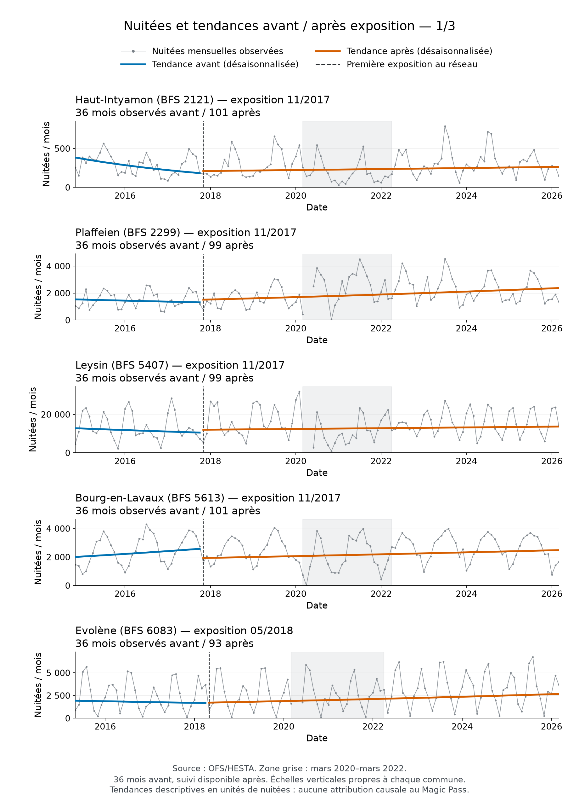
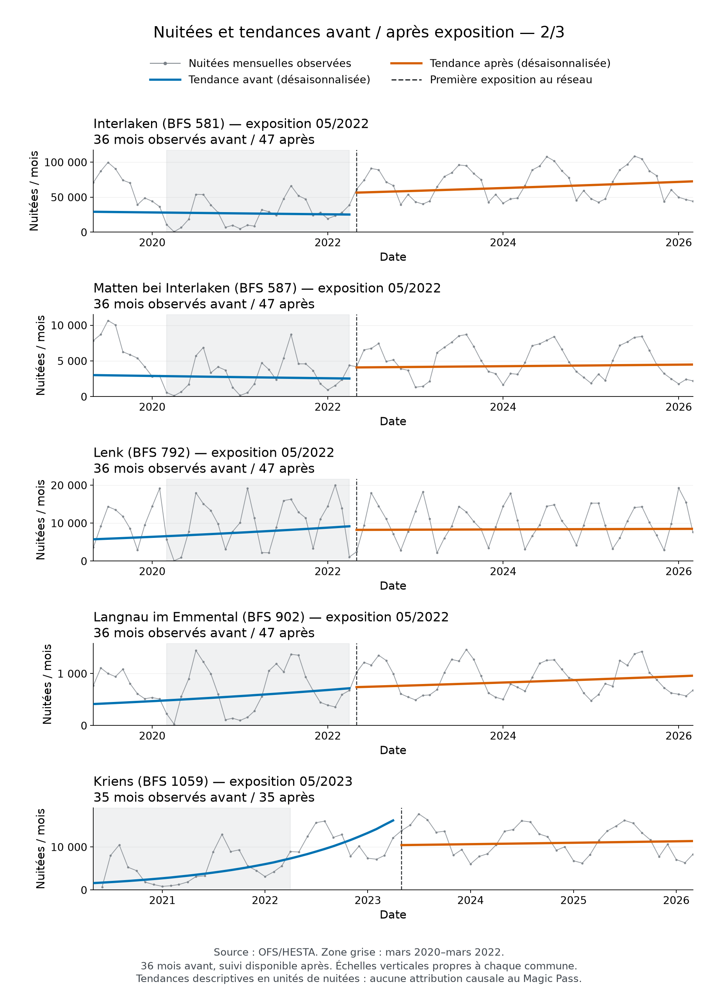
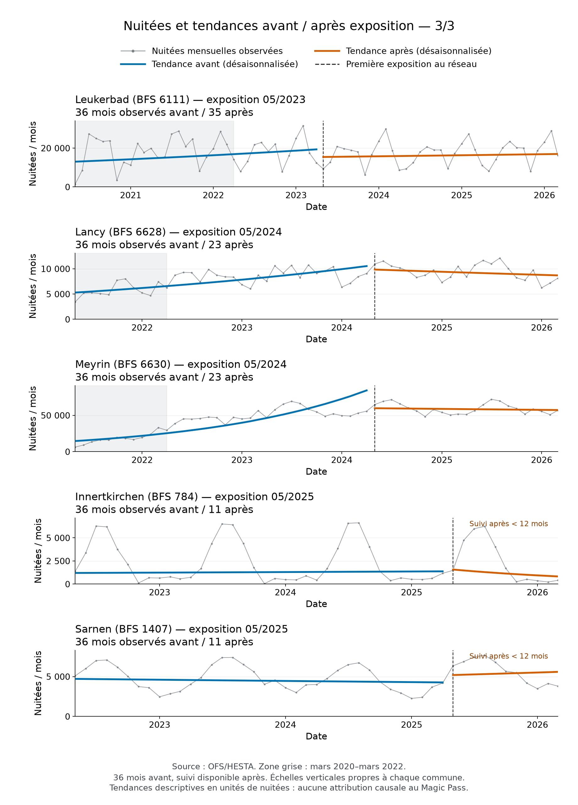

# Nuitées et tendances de 15 communes

Choix A approuvé le 5 octobre 2026. Quinze communes tirées sans remise parmi les 76 calculables, avec la graine 20261005 et les identifiants BFS triés. Ce choix sert uniquement à illustrer les séries : il ne modifie aucun échantillon ni résultat du rapport 82.

## Planche 1

## Planche 2

## Planche 3

## Lecture et méthode

Gris : nuitées hôtelières mensuelles HESTA originales. Bleu : tendance avant exposition. Orange : tendance après. Verticale noire : première exposition communale au réseau Magic Pass accessible, pas entrée d'une station ni localisation de la station. Le seuil reste les 120 minutes de la matrice actuelle, tenue fixe historiquement : ces dates ne valident pas l'accessibilité passée. Fond gris : période COVID documentée (mars 2020–mars 2022), conservée dans les ajustements. Les axes verticaux ont leur propre échelle pour rendre chaque série lisible.

Fenêtre : 36 mois avant la première exposition, puis tous les mois jusqu'à la dernière nuitée observée. Une valeur manquante crée un trou dans la série brute ; aucun remplissage. Les deux suivis après de moins d'un an sont signalés.

La calibration saisonnière reprend exactement les onze coefficients locaux pré36 du rapport 82, estimés sur log(1 + nuitées) avec intercept et temps calendaire. On les centre sur les douze mois, puis soustrait le profil aux observations avant **et** après. Ce même profil prétraitement est conservé, sans le réestimer sur les données postérieures. Deux régressions descriptives intercept + temps calendaire sont ensuite ajustées séparément aux valeurs corrigées observées avant et après. Les courbes affichées sont exp(tendance log1p) − 1, en unités de nuitées. Elles représentent un niveau désaisonnalisé, pas une moyenne arithmétique prédite ou un effet causal. Elles peuvent être courbes même si la pente est linéaire sur l'échelle logarithmique.

Un profil saisonnier stable après entrée est une hypothèse de lecture. Changement de saisonnalité, COVID, nouveaux hôtels et autres entrées accessibles peuvent modifier les courbes. La comparaison de deux pentes ne sépare pas ces phénomènes et n'utilise pas de témoins ; aucun intervalle, test ou effet du Magic Pass n'en est déduit.

## Sources et reproduction

Sources existantes : OFS/HESTA (`BFS_HOTEL_DATA`), panel territorial avec Moutier raccordé, première exposition et calibration du rapport 82. Aucun téléchargement ni changement des valeurs sources. Nouvelle source dérivée : `DERIVED_ACCESSIBILITY_COMMUNE_TREND_PLOTS`. Config, identifiants tirés, formules, coefficients, points, empreintes et versions sont conservés dans `config/accessibility_commune_trend_plots.json`, `data_processed/accessibility_commune_trend_plot_points.json` et `accessibility_commune_trend_plot_summary.json`.

Reproduction : `.venv/Scripts/python.exe src/descriptive/plot_accessibility_commune_trends.py`, puis mise à jour de la provenance. Le script vérifie le tirage figé et s'arrête si l'univers a changé, plutôt que choisir d'autres communes automatiquement.
